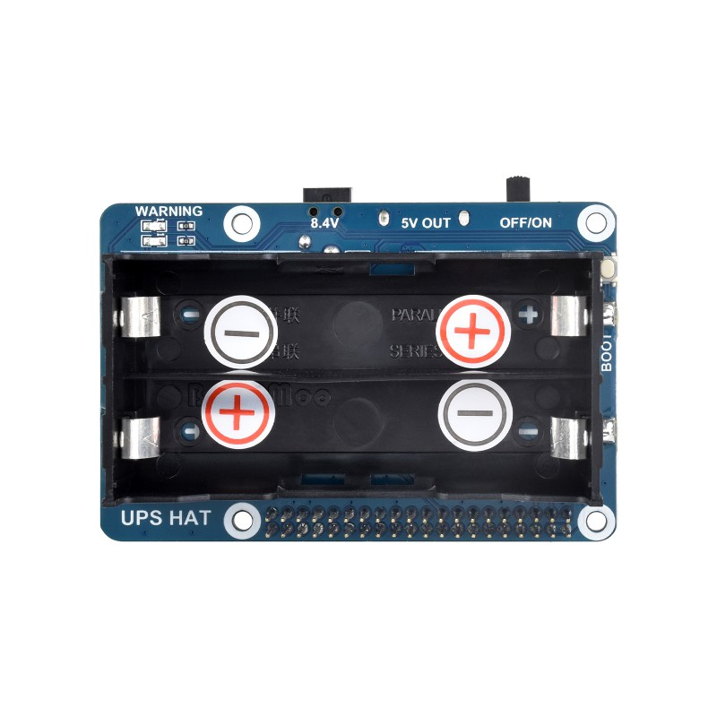

# Waveshare UPS HAT — Battery Monitor & Safe Shutdown



Enhancements for the [Waveshare UPS HAT](https://www.waveshare.com/product/ups-hat.htm) for Raspberry Pi, based on the [official demo code](https://www.waveshare.com/wiki/UPS_HAT).

## Features

- **Battery monitoring tray icon** — live voltage, percentage, and charging state in the desktop system tray
- **Automatic shutdown on low battery** — configurable voltage thresholds trigger a graceful countdown shutdown
- **Auto installer** — one-command setup via `install.sh`

---

## Files in this package

| File | Purpose |
|---|---|
| `batteryTray.py` | Desktop system-tray battery indicator |
| `ups_shutdown.py` | Headless shutdown monitor (runs as a systemd service) |
| `ups-shutdown.service` | Systemd unit file for the shutdown monitor |
| `battery.sh` | Shell launcher for the tray app |
| `battery.desktop` | Autostart entry (placed in `~/.config/autostart/`) |
| `install.sh` | One-command installer |
| `INA219.py` | Original INA219 terminal monitor (unchanged) |

---

## Quick start

```bash
# 1. Copy this folder to your Raspberry Pi (e.g. via scp or USB)
scp -r ups_hat/ pi@raspberrypi.local:~/ups_hat/

# 2. SSH in and run the installer
ssh pi@raspberrypi.local
cd ~/ups_hat
sudo bash install.sh
```

That's it. The installer will:
- Install Python packages (`smbus`, `PyQt5`)
- Enable I²C
- Add your user to the `i2c` group
- Set up the tray app to launch at desktop login
- Install and start the shutdown monitor as a systemd service

---

## Manual installation (step by step)

### Prerequisites

```bash
sudo apt update
sudo apt install -y python3-smbus python3-pyqt5
# Or via pip:
pip3 install smbus PyQt5 --break-system-packages
```

### Enable I²C

```bash
sudo raspi-config
# → Interface Options → I2C → Yes
```

Reboot, then verify your INA219 is visible:

```bash
i2cdetect -y 1
# You should see '42' in the grid
```

### Tray app (desktop autostart)

```bash
chmod +x ~/ups_hat/battery.sh ~/ups_hat/install.sh

# Create autostart directory if needed
mkdir -p ~/.config/autostart

# Install autostart entry
sed "s|PLACEHOLDER_PATH|${HOME}/ups_hat|g" battery.desktop \
    > ~/.config/autostart/battery.desktop

# Launch immediately (without rebooting)
DISPLAY=:0.0 python3 ~/ups_hat/batteryTray.py &
```

### Shutdown service (headless / background)

```bash
# Edit the service file if your install path differs from /home/pi/ups_hat
nano ups-shutdown.service

sudo cp ups-shutdown.service /etc/systemd/system/
sudo systemctl daemon-reload
sudo systemctl enable --now ups-shutdown.service

# Check it's running
sudo systemctl status ups-shutdown.service
```

---

## Configuration

Open `batteryTray.py` **and** `ups_shutdown.py` and adjust the constants near
the top of each file:

```python
I2C_ADDR              = 0x42   # INA219 I²C address (confirm with i2cdetect -y 1)

# 2S Li-ion pack voltages
BATT_FULL_V           = 8.4    # 100% — 4.20 V/cell × 2
BATT_EMPTY_V          = 6.0    # 0%   — 3.00 V/cell × 2

LOW_VOLTAGE_V         = 6.4    # Warn at this voltage (3.20 V/cell)
SHUTDOWN_VOLTAGE_V    = 6.2    # Hard shutdown floor  (3.10 V/cell)  [ups_shutdown.py only]
SHUTDOWN_SECS         = 60     # Countdown before poweroff

CHARGING_THRESHOLD_MA = 50     # mA above this = charging
```

**If your battery pack is different** (e.g. 3S), adjust `BATT_FULL_V`,
`BATT_EMPTY_V`, `LOW_VOLTAGE_V`, and `SHUTDOWN_VOLTAGE_V` accordingly.

---

## How it works

### Charging detection

The INA219 measures current direction across the shunt resistor:

- **Current > +50 mA** → charger connected (charging)
- **Current < −50 mA** → running on battery (discharging)
- **Between ±50 mA**  → idle / float

### Battery percentage

`ups_shutdown.py` owns the percentage — load-compensated voltage through a real Li-ion
curve, with coulomb counting on top (see the sections below). It publishes every
sample to **`/run/ups_hat/status.json`**, and the tray and Fleet Command read that file
(since 2026-11-06), so all three show the same number.

The original linear line through raw terminal volts,

```
percent = (voltage − 6.0 V) / 2.4 V × 100
```

survives only as the tray's and Fleet Command's **fallback** when the status file is
missing or stale. Do not trust it: plugging in the charger lifts the terminal voltage
~1.4 V in seconds, which this line reads as a 60-point jump (see below).

### Safe shutdown flow

1. `ups_shutdown.py` (or `batteryTray.py`) detects voltage below `LOW_VOLTAGE_V`
   for 5 consecutive readings while not charging.
2. A 60-second countdown begins (visible in the log / tray warning dialog).
3. If a charger is connected during the countdown, it is cancelled.
4. If the countdown expires, `sudo poweroff` is called for a clean shutdown.
5. A hard-shutdown threshold (`SHUTDOWN_VOLTAGE_V = 6.2 V`) triggers an
   immediate poweroff regardless of the countdown.

---

## Troubleshooting

| Symptom | Check |
|---|---|
| `No such file or directory: '/dev/i2c-1'` | I²C not enabled — run `sudo raspi-config` |
| `[Errno 121] Remote I/O error` | Wrong I²C address — run `i2cdetect -y 1` and update `I2C_ADDR` |
| Tray icon doesn't appear | Make sure `DISPLAY=:0.0` is set; try running `batteryTray.py` from a terminal in your desktop session |
| `PyQt5` import error | `pip3 install PyQt5 --break-system-packages` |
| Shutdown service not starting | `sudo journalctl -u ups-shutdown -n 50` |
| Percentage reads 0% when battery is full | Voltage calibration — check `BATT_FULL_V` and `BATT_EMPTY_V` |

---

## Logs

- Tray app log:      `~/ups_hat/battery.log`
- Shutdown service:  `~/ups_hat/ups_shutdown.log`  
  and `sudo journalctl -u ups-shutdown -f`

## Battery percentage: load-compensated, not raw voltage (fixed 2026-09-01)

**Symptom:** unplug the mains and the percentage falls; plug it back and it rises.
No charge moved. The reading was tracking **load**, not charge.

**Cause.** The old formula was a straight line through terminal voltage:

```python
pct = (v - 6.0) / (8.4 - 6.0) * 100
```

Two independent errors in one line.

**1. Terminal voltage sags under load.** The pack's internal resistance was measured
here by stepping CPU load and fitting V against I:

| method | current span | result |
|---|---|---|
| **on battery, load step** | **561 mA**, residual sd 19.8 mV | **579 mΩ ← used** |
| on mains, load step | 210 mA, residual sd 4.6 mV | 511 mΩ |
| on mains, float noise, 10,782 samples | 396 mA about zero | 602 mΩ |

The battery figure is the one to use: compensation only does anything while
discharging, so it belongs in that topology, and with the charger out of the loop the
current span is nearly three times wider. The 68 mΩ gap against the mains figure is the
charger's own regulation, which is not in circuit when it matters.

At 511 mΩ:

| load | sag | old reading fell by |
|---|---|---|
| 0.5 A | 301 mV | 12.5 points |
| 1.0 A | 602 mV | 25.1 points |
| 2.0 A | 1.20 V | **50.1 points** |

**2. Li-ion is not linear in voltage.** The curve is flat through the middle, so a
straight line over-reports badly where it matters — at 3.70 V/cell it claimed **58%**
when the pack holds about **17%**.

**Fix.** Undo the IR drop, then interpolate a real cell curve:

```python
v_oc = v - PACK_R_OHM * (current_ma / 1000)     # + is charging
pct  = soc_percent(v_oc)                        # 13-point OCV table, per cell
```

Verified in production twice — on mains against a 180 mA step, then on battery against a
527 mA step, which is the case that matters:

```
on mains,  before   8.232V  +7.9mA  93.0%   8.128V  -182.7mA  88.7%   4.3 points of nothing
on mains,  after    8.220V  -4.9mA  91.1%   8.128V  -177.9mA  90.9%   0.2 points

on battery, old formula would read       7.712V  71.3%   7.428V  59.5%   11.8 points
on battery, actual reading               7.712V  87.6%   7.428V  88.7%    1.1 points
```

That second block is the real test: 284 mV of terminal sag across the step, and the
reported charge barely moves.

The log now prints both: `8.128V (oc 8.221V) -177.9mA 1.448W 90.9% [DIS]`.

### Validated by a current reversal

The strongest check was accidental. Unplugging and later reconnecting the mains reverses
the current through the pack, and the compensated voltage should not notice:

```
before mains   6.912 V @  -759.6 mA  ->  V_oc 7.352 V   14.9%
after  mains   7.892 V @  +898.7 mA  ->  V_oc 7.372 V   15.5%
```

**Terminal voltage jumped 980 mV across a 1658 mA reversal. Compensated V_oc moved 20 mV.**
A wrong `R` of δ would show as a jump of δ × 1.658 A, so 20 mV puts δ at **12 mΩ** — the
579 mΩ figure is good to about 2%.

The old formula across the same instant would have read **38.0% → 78.8%**, jumping 40 points
at the moment a plug went in.

⚠ `PACK_R_OHM` is the resistance **seen at the INA219** — pack, wiring and whatever the
charger presents. With mains unplugged the topology changes and it may differ. Re-measure
on battery to refine it.

### The charging flag was noise

`chg = current > 50 mA` against a float current of **+4.3 mA mean over −276…+120 mA**
read "charging" in 2% of samples while on mains, flipping CHG/DIS at random. Replaced with
hysteresis on a 5-sample average: on above 80 mA, off below 20 mA.

## Shutdown thresholds — on compensated voltage (changed 2026-09-01)

| condition | action |
|---|---|
| `v_oc < 6.2 V` and not charging | **immediate `poweroff`** |
| `v_oc < 6.4 V` and not charging, 5 reads (10 s) | warn, then **60 s countdown**; cancelled if voltage recovers or charging starts |
| **`v` (raw) < 5.6 V** | **immediate `poweroff`, compensation bypassed** |

**`6.4` and `6.2` were always meant as resting per-cell figures** — 3.20 and 3.10 V/cell.
Applied to a terminal reading taken while the pack delivers an amp they fired early:

| load | fired at (terminal) before | now |
|---|---|---|
| 0.40 A | 6.40 V | 6.17 V |
| 0.76 A | 6.40 V | 5.96 V |
| 1.20 A | 6.40 V | 5.71 V |

The gain in charge is modest — 3.42 V/cell is ~9% and 3.20 V/cell ~5%, because the curve
is steep there — but the behaviour is now what the constants always claimed.

### Three guards, because every error here delays shutdown

Compensation can only **raise** the apparent voltage, so every way it can go wrong makes
the Pi run longer on a flatter battery. Bounded three ways:

| guard | value | catches |
|---|---|---|
| `SANE_CURRENT_A` | 5.0 A | a bad I²C read; beyond this, no compensation at all |
| `MAX_COMPENSATION_V` | 0.80 V | a plausible-but-large current inflating V_oc (≈1.4 A at 579 mΩ) |
| `RAW_FLOOR_V` | 6.10 V *(5.60 until 2026-11-06)* | everything else — raw terminal volts, no compensation, no `not charging` exemption |

Tested:

```
6.40 V @  -0.76 A  ->  6.840   normal, +0.440 V
6.40 V @ -20    A  ->  6.400   absurd current ignored
6.40 V @  -4    A  ->  7.200   capped (uncapped would be 8.716)
7.90 V @  +0.90 A  ->  7.379   charging, correction inverts
```

Worst case, if the compensation misbehaves entirely, the raw floor — now 6.10 V, 3.05 V/cell
under load — still fires. ⚠ At 5.60 V it was **below where this box actually dies**; see
*The pack has failed* below for the 2026-09-21 power cut that slipped past all three guards.


## The supply is at its limit — the HackRF stops the pack charging

Observed 2026-09-01: plugging in the HackRF made the reported charge fall several points
immediately. It is real, and it is not the compensation.

The PortaPack re-enumerated as `1d50:6018` (Mayhem UI mode, which is when it charges its
own battery) and took the charger's entire surplus:

| | mean pack current | percentage | terminal |
|---|---|---|---|
| before HackRF | **+227.5 mA** charging | 82.4 → 84.3 ↑ | 8.196 V |
| after HackRF | **−21.4 mA** discharging | 84.7 → 81.5 ↓ | 8.024 V |
| settled | +10 mA | flat | 8.03 V |

**Not a compensation artifact.** At ~0 mA the correction is **6 mV** — the displayed figure
is effectively raw terminal voltage, so the load-compensation work is not involved in this
drop in either direction.

Two real effects make it up:

1. **Charging stopped.** The pack no longer gains from charge current, and briefly supplied.
2. **Surface-charge relaxation.** A Li-ion cell reads high for 10–30 minutes after charging
   and settles as the surface charge equalises. Part of that 84.7% was never really there.
   Any percentage read within half an hour of charging is optimistic.

### What it means operationally

- **The Pi's pack will not recharge while the HackRF charges.** It sits balanced near 0 mA
  and stays where it is.
- **Extra load tips it negative.** Four busy cores draw 1.2 A here; with the HackRF also
  charging, that comes out of the pack — **while plugged into mains**.

Nothing unsafe: the protection works and the pack is at ~81%. But "on mains" no longer
implies "charging", and for a long session the HackRF wants its own supply.


## Surface charge: readings are optimistic for ~20 min after charging

Unplugging the mains dropped the reported charge from **81% to ~50%** within six minutes.
That looked like the compensation failing again. It was not — the 81% was the wrong number.

**The compensation is working.** Two samples 30 s apart under very different load:

```
terminal 6.860 V @ -1324 mA  ->  V_oc 7.627
terminal 7.196 V @  -847 mA  ->  V_oc 7.686
         336 mV of terminal swing became 59 mV of V_oc  -- 82% of the load effect removed
```

At steady ~800 mA, V_oc held flat within **16 mV** over two minutes.

**And the fall cannot be capacity.** V_oc went 8.13 → 7.61 V in six minutes at ~1.2 A, which
is **0.12 Ah**. On the curve 4.06 → 3.81 V/cell is ~84% → ~50%; a 34-point fall from 0.12 Ah
would need a **0.4 Ah pack**. This is 2× 18650, about 3 Ah. The arithmetic rules it out.

What actually happened is **surface charge**. The pack had been charging until the HackRF took
the charger's surplus, and a recently-charged cell sits well above its equilibrium voltage.
A 1.2 A load strips that in minutes, and the sequence shows it settling rather than falling:

```
8.126 -> 7.987 -> 7.893 -> 7.797 -> 7.664 -> 7.627  then flat at 7.61-7.69
```

Real discharge does not level off like that.

**This is inherent to any voltage-based state of charge**, not a flaw in this formula.
Voltage reports the cell's equilibrium potential, and after charging it takes tens of minutes
at rest — or minutes under load — to actually get there. The cure is **coulomb counting**:
integrate the INA219's current, which measures charge directly, and demote voltage to a slow
correction. Not yet done.

Until then the log marks the window: `... 62.7% [CHG] ~settling`, for `SETTLE_SECS` (20 min)
after charging stops.

### R re-measured: 610 mΩ

Fitted at ~1 A load, and **with a time term** — `V = a + b·t + R·I`. Over anything longer
than a few tens of seconds the pack visibly drains, and a plain V-against-I fit charges that
drift to the current instead. The same data gave **325 mΩ without the time term and 610 mΩ
with it**; the residual fell from 126 mV to 16 mV.

| measurement | span | R |
|---|---|---|
| **on battery, ~1 A load, time term** | 677 mA | **610 mΩ ← used** |
| on battery, lighter load | 561 mA | 579 mΩ |
| on mains, load step | 210 mA | 511 mΩ |
| on mains, float noise | 396 mA | 602 mΩ |

The spread is real: R depends on current, charge and temperature, so a single constant is an
approximation. It is a good one — 610 vs 579 is 24 mV at 0.8 A — but it is not exact.

## Coulomb counting (2026-09-01)

Voltage reports a cell's *equilibrium* potential. Right after charging it is nowhere near
equilibrium — surface charge was worth **~30 points** here — and under load it is masked by
IR drop. Integrating current measures charge directly instead of inferring it.

```
soc_ah += I · dt                      every poll, I positive = charging
```

The integrator drifts (INA219 offset accumulates), so voltage is kept as a **slow anchor**:
**the counter owns the short term, voltage owns the long term.**

| mechanism | when | what it does |
|---|---|---|
| integrate | always | tracks charge in and out |
| voltage anchor | `\|I\| < 50 mA` **and** ≥20 min since charging | pulls toward the voltage estimate at 2%/sample (~2 min) |
| full reset | charging, ≥4.15 V/cell, current tapered | sets 100% — the one point where voltage is unambiguous |
| capacity learning | between two anchored points ≥25 points apart | Ah moved ÷ fraction moved |

State persists to `/var/lib/ups_hat/state.json`, written atomically every 30 s so a power
cut cannot leave it half-written. The log now shows both opinions:

```
8.112V (oc 7.931V)  +296.0mA  2.033W  75.6% (v 75.1%)  [CHG] ~settling
                                       ^counted  ^voltage
```

### ⚠ Safety is deliberately NOT on the counter

All three shutdown paths still read voltage only — `v` for the raw floor, `v_oc` for the two
thresholds. **An integrator that has drifted must never be able to talk the monitor out of
powering off.** Verified after each change:

```
if v     < RAW_FLOOR_V           # raw terminal, bypasses everything
if v_oc  < SHUTDOWN_VOLTAGE_V    # hard
if v_oc  < LOW_VOLTAGE_V         # warn + countdown
```

### Capacity, and what it says about the pack

Seeded at **0.80 Ah** and learned from use. That seed comes from a measurement, not a
datasheet: a 38-minute discharge on 2026-09-01 delivered **0.445 Ah** across a voltage-implied
69.7 points, giving **0.64 Ah** — and that under-states it, because the start was
surface-charge inflated.

Healthy 18650s in 2S would be 2–3 Ah. **If the learned figure settles near 1 Ah, that is a
statement about the cells, not a bug in the counter.** Watch the `capacity estimate` lines.

### Tested

Simulated against a pack of known capacity:

- tracks a 10-minute 1 A discharge to **0.1 points**
- with the capacity guess **44% too small**, drifts 14.9 points during discharge and the
  anchor pulls it back to **0.0** after 30 minutes at rest

⚠ The simulation derives voltage from true state of charge, so it contains **no surface
charge** — it cannot demonstrate the thing this change exists for. That needs a real
charge/discharge cycle to confirm.

## The pack has failed — and why the percentage jumped on plug-in (2026-11-06)

Reported as "the percentage becomes near full suddenly when connected to power". Three
separate causes, one of them the cells.

### 1. The tray and Fleet Command never got the 2026-09-01 fix

Both still computed `(V − 6.0) / 2.4` on raw terminal volts. On 2026-11-05 at 14:08:

| time | terminal | current | tray / Fleet Command | service counter |
|---|---|---|---|---|
| 14:08:14 (on battery) | 6.592 V | −1026 mA | **24 %** | 80.0 % |
| 14:08:18 (plugged in) | 8.032 V | +208 mA | **84 %** | 80.0 % |
| 14:12 | 8.25 V | +63 mA | **94 %** | 81.0 % |

Sixty points in four seconds, with no charge moved — the charger lifting the bus. **Fixed:**
the service now publishes `/run/ups_hat/status.json` (`pct`, `v_pct`, `v`, `v_oc`,
`current_ma` positive = charging, `state`, `settling`, `capacity_ah`, `ts`; tmpfs, atomic,
0644) and both readers use it when it is fresher than 10 s (tray) / 30 s (Fleet Command).

Found along the way: **Fleet Command's charge direction was inverted for this box.** Its
snippet read *shunt negative = charging* (true of the other INA219 modules in the fleet);
here the shunt and current registers share a sign and **positive = charging** (verified
2026-11-06), so on battery it said "charging". Fixed in the fallback path too.

### 2. The counter also jumps — when the settling window expires

The service's counter rose only 80.0 → 82.1 % in the first half hour on mains, then
**82 → 92.6 % in ten minutes at 14:40** — exactly when `SETTLE_SECS` (20 min) ran out.
After that any |I| < 50 mA counts as "at rest", and the anchor (gain 0.02/sample, τ ≈ 100 s)
pulls the counter to the voltage opinion. On this box |I| < 50 mA **only ever happens on
mains** (on battery the load is ≥ 0.6 A), so the anchor always reads the pack pinned at the
charger's float (~8.25 V, ~92 %), never a true rest.

> **Corrected later the same day:** the anchor was *not* misreading. After 20 min at float
> with ~0 current the pack is at equilibrium, and ~92 % was right — the failed pack really
> was "full" of the ~0.13 Ah it could still hold. The counter was what was wrong: it
> believed 0.80 Ah, so 0.02 Ah back in looked like 2 points. The snap was the anchor
> correcting a capacity 6× too large. The anchor is unchanged.

Same root cause: **the capacity learner has never fired.** It needs two anchored points
≥ 25 points apart, and every anchor lands near 92 %. `capacity_ah` is still the 0.80 Ah
seed. **Fixed 2026-11-06** — see *Capacity learner, rewritten* below.

### 3. The cells: usable charge fell ~5× in two weeks

Integrated INA219 current per discharge since coulomb counting started:

| discharge | duration | delivered | ended |
|---|---|---|---|
| 09-04 | 57 min | 0.70 Ah | plugged in at 2 % |
| 09-07 | 35 min | 0.45 Ah | plugged in |
| 09-08 | 33 min | 0.53 Ah | plugged in at 5.97 V |
| 09-09 | 43 min | 0.70 Ah | plugged in at 5.86 V |
| **09-21** | **7 min** | **0.135 Ah** | **power cut** |
| **11-05** | **10 min** | **0.123 Ah** | voltage collapsing (V_oc 3.55 V/cell), plugged in |

Charge acceptance collapsed with it: on 09-04 the pack took a steady **+870 mA** after
plug-in; on 11-05 it took **+260 mA, tapering to +40 mA within four minutes**, and reached
float having taken back ~0.02 Ah of the 0.12 Ah drawn. Dies in ten minutes, "fills" in
four: the signature of a very high-impedance cell, most likely one of the two in series.
So "near full quickly" is partly the pack, not the arithmetic — **no percentage
calculation fixes this. Replace both 18650s with a matched pair.**

With `capacity_ah` still at 0.80 Ah the counter is now **far too optimistic on battery**
(it read 80 % on 11-05 as the voltage collapsed). Safety does not use it, but do not trust
the displayed % on battery until the cells are replaced and capacity re-seeded.

### The 09-21 power cut, and the raw floor raised to 6.10 V

On 2026-09-21 at 13:22 the Pi lost power at **6.00 V terminal / 1.7 A** with the counter at
73 %. No guard fired: the compensation, capped at +0.80 V, held V_oc at 6.80 V (far above
the 6.2 V hard threshold), and the raw floor was 5.60 V. The clock rewinding to 13:19 on the
next start (no RTC) marks it as a hard power loss, not a shutdown.

`RAW_FLOOR_V` is now **6.10 V**. Every sample below 6.10 V since 2026-09-01 came from a
near-empty pack (09-08, 09-09, 09-21; all ≤ 9.5 % by voltage), so it costs no runtime; on
09-21 it would have fired **16 s before** the cut. 09-08 and 09-09 survived 5.97 / 5.86 V,
so where the box browns out depends on the transient — 6.10 V is a margin, not a
measured cliff.

**The tray follows the service (since 2026-11-06).** `status.json` also carries `warn` and
`shutdown_in` (seconds; 0 = powering off now), written after each sample's shutdown checks.
While the file is fresh the tray only *mirrors* the service — a non-modal warning showing
the service's countdown, dismissed when the service cancels — and **never powers off
itself**. Its old rule (raw terminal volts < 6.4 V → 60 s → `poweroff`) runs only while the
file is stale, i.e. the service is down and nothing else guards the pack; if the service
comes back mid-countdown, the tray drops its own. On raw volts that rule fired 1–3 % before
the service with the new cells, and far earlier on the worn pack (4× the sag). Tested
headless with `poweroff` stubbed: 8/8 cases — service fine at raw 6.30 V → nothing; service
warns → its countdown shown, tray ticks never power off; service cancels → dismissed;
service stale → fallback countdown and poweroff; service returns → fallback stopped.

**A third charge state: on AC (2026-11-06).** The service's `state` is only `CHG` / `DIS`, and
`DIS` means *not charging* — the tray printed it as "Discharging" while the pack sat on mains
topping off at +30…+60 mA, and Fleet Command flashed 🔋 on any instant reading below −100 mA
(float current swings −198…+114 mA). `status.json` now also carries **`power`** =
`charging` / `discharging` / `ac`, from the 10 s average current with hysteresis: draining
below **−250 mA**, released above **−150 mA**. Over 11-05…06 that average sat above −81 mA 99 %
of the time on mains and never above −401 mA on battery. A pack that genuinely drains on
mains (supply at its limit, see above) reads `discharging`, which is true. The tray shows
"Charging ⚡" / "Discharging" / "On AC" / "On AC — full" (≥ 95 %); Fleet Command maps the same
field to ⚡ / 🔋 / 🔌 / ✓.

### Cells replaced — 2026-11-06

Old: **PROFUSE 2600 mAh** ×2 — already down to 0.70 Ah (27 % of rating) at the start of
September, ~0.13 Ah (5 %) by 09-21. New: **Aspilsan INR18650A28, 2800 mAh / 25 A** ×2, so
**2.8 Ah** for the series pack. `NOMINAL_CAP_AH` is now 2.80; the old state was moved to
`/var/lib/ups_hat/state.json.old-pack-20261106` and the counter re-seeded from voltage
(89 % at 12:50, on mains, charging). Step 1 below is done; 2 and 3 are not.

### Plug test with the new cells — no jump (2026-11-06)

Mains pulled at 13:54:07 and restored at 13:55:46, recorded every 2 s from the service,
the tray and Fleet Command (on lapivaio) side by side:

| | service | tray | Fleet Command |
|---|---|---|---|
| on mains, before | 92.3 % | 92 % | 92 % 🔌 |
| 1.5 min on battery (−0.73 A) | 92.3 → 91.7 % | 92 % | 92 → 91 % 🔋 |
| re-plugged, +3 min | 91.7 → 91.9 % | 92 % | 91 % ⚡ |

No jump either way. The 0.6-point fall is the coulomb count: 0.73 A × 99 s = 0.020 Ah of
2.8 Ah. Fleet Command's icon followed within one poll (🔋 → 🔌 → ⚡ over ~15 s, the service's
charging hysteresis included). For contrast, raw volts read 8.13 V on battery and 8.26 V
on mains: the old line would have stepped 88.7 → 94.2 %.

**It exposed a stale `PACK_R_OHM`.** Both mains steps measure the new pack at
**140 mΩ** (unplug 137–139, re-plug 136–143) — against 610 mΩ for the worn pack, itself a
symptom of the failing cell. With 0.610 left in, V_oc read **8.60 V under a 0.73 A load
(100 % by voltage)**, and every threshold on V_oc fired ~0.35 V late at that current (0.8 V
late, capped, at 1.4 A+) — the raw floor was the only guard working as designed.
`PACK_R_OHM` is now **0.140**: on battery V_oc reads 8.23 V, agreeing with the counter.

### After replacing the cells

1. Stop the service, delete `/var/lib/ups_hat/state.json`, start it (re-seeds from voltage).
2. Do one full discharge on battery to near-empty and set `capacity_ah` from the delivered
   Ah, or make the learner work from discharges rather than from rest anchors.
3. ~~Consider gating the anchor on "not on mains"~~ — withdrawn; the anchor was right (see
   the correction under *2. The counter also jumps*).

## Capacity learner, rewritten (2026-11-06)

The old learner needed two **at-rest** readings ≥ 25 points apart. Here the pack is only at
rest on mains at the charger's float (~92 %), so in two months it never fired, while the
pack wore from ~0.9 Ah to ~0.13 Ah. It also measured charge with `soc_ah`, which the anchor
itself moves and which clamps at 0 and full: circular.

`CapacityLearner` (pure logic, no I/O):

- **Reference** — the last anchored reading: at rest, ≥ 20 min past charging. Here that is
  the pack at float, a genuine equilibrium.
- **End point** — during the next discharge (≥ 150 mA), the IR-compensated V_oc averaged
  over 60 s, once it is **≤ 3.55 V/cell (~12 %)**. Down there the curve runs ~22 %/V, so
  the polarisation left after the IR correction — which always reads *low* on discharge —
  costs ~2 points even at 100 mV/cell.
- **Charge** — a separate signed coulomb total, never clamped or anchored.
- Needs ≥ 40 points between the two; **one estimate per discharge**; any charging in between
  voids the reference. The estimate moves capacity by `CAP_LEARN_GAIN` (25 %), the counter is
  re-set on the end-point reading, and state is saved at once (a shutdown may follow).
- **Shutdown logic is untouched** — still voltage only.

**Why so deep.** With the end point at the curve's 3.74 V/cell boundary (20 %), replaying the
old pack's discharges gave **0.63 / 0.56 Ah** against ~0.86–0.90 Ah delivered between trusted
points: ~95 mV of polarisation had it reading 15 % with a third of its charge left.

Tested — synthetic pack of known capacity, polarisation the IR correction does not remove:

| case | estimate |
|---|---|
| 2.8 Ah, 0.75 A, no polarisation | 2.807 Ah (+0.2 %) |
| 2.8 Ah, 0.75 A, 25 mV/cell | 2.789 Ah (−0.4 %) |
| 2.8 Ah, 1.7 A, 50 mV/cell | 2.779 Ah (−0.7 %) |
| failed pack 0.15 Ah | 0.156 Ah (+4 %) |
| discharge stopped at 40 % | none (correct) |

…and replayed against the real log (old pack):

| discharge | ~truth | at 3.60 | **at 3.55** | at 3.50 | at 3.45 |
|---|---|---|---|---|---|
| 09-04 | 0.88 Ah | 0.724 | **0.788** | 0.854 | — |
| 09-09 | 0.86 Ah | 0.630 | **0.674** | 0.713 | 0.753 |
| 09-08 | — | 0.598 | **0.640** | — | — |
| 09-07 (stopped at 44 %) | — | — | **—** | — | — |

Deeper is more accurate but rarer: at 3.50 the 09-08 discharge teaches nothing, at 3.45 only
one of three does. **3.55 learns from every discharge that nears shutdown, reads within 1 %
on cells that polarise like healthy ones, and errs LOW (10–22 %) on a worn, high-resistance
pack** — the safe direction: a pessimistic %. ⚠ The 11-05 collapse of the failed pack taught
nothing: it was re-plugged before the 60 s average got below 3.55 V/cell. A failing pack that
is allowed to run on towards shutdown is caught.

The new pack has not yet been through a deep discharge, so **2.8 Ah is still the rated seed**.
Watch for `capacity estimate` lines in `ups_shutdown.log` after the first one.

## Full reads 100% — the % is now a share of what this charger fills (2026-11-07)

**Symptom**: after a full overnight charge the reading sat at **94.4%** for hours. The pack was full:
the charger had finished at ~02:40 (8.264 V, +41 mA taper), and on mains it then rested at
**8.28–8.30 V = 4.14–4.15 V/cell**. The 13-point cell curve reaches 100% only at 4.20 V/cell, so
it called that ~94%.

**Change** (`ups_shutdown.py`):
- `soc_percent()` = chemistry curve ÷ its value at **`CHARGER_FULL_CELL_V = 4.14`**
  (`FULL_FRACTION` = 0.94), capped at 100. The scale is uniform, so the learner stays consistent:
  it measures capacity in the same points it then divides by. Low end moves by ≤ 0.6 points
  (6.9 V: 10.0 → 10.6%).
- **Stored capacity converted once**: `state.json` now records `full_fraction`. A state without it
  is on the old 1.0 scale and is multiplied by 0.94 on load (2.713 → **2.551 Ah**, logged as
  `capacity rescaled to charger-full`). The seed for a fresh state is `NOMINAL_CAP_AH × 0.94`.
- **`FULL_CELL_V` 4.15 → 4.12**: the "charging + tapering ⇒ full" snap never fired, because under
  taper this charger's V_oc is ~4.13 V/cell. That is why the counter read 85.7% at end of charge
  and jumped to 93% only when the 20-min anchor kicked in.
- **Shutdown is untouched**: every threshold compares volts (V_oc 6.4/6.2 V, raw floor 6.10 V),
  never a percent.
